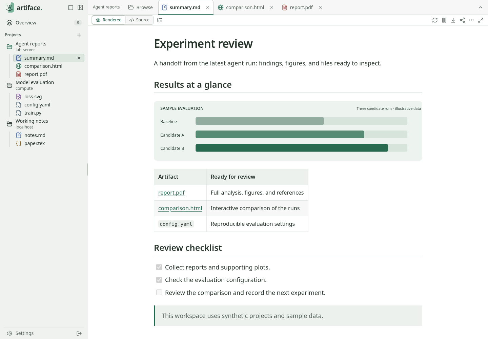

<p align="center">
  
</p>

<h1 align="center">Artiface</h1>

<p align="center"><strong>View your AI agents' artifacts in one space.</strong></p>
<p align="center">Browse reports, plots, documents, and code on local and SSH machines, from your browser.</p>

<p align="center">
  <a href="#quick-start">Quick start</a> ·
  <a href="docs/FEATURES.md">Features</a> ·
  <a href="docs/guide-quick.md">User guide</a> ·
  <a href="CONTRIBUTING.md">Contributing</a>
</p>



[Dark theme](docs/assets/workspace-dark.png) · [Phone view](docs/assets/mobile.png)

## Check the output efficiently

Coding agents and experiments leave useful work scattered across machines: an HTML report here, a PDF there, a folder of plots somewhere else.
Artiface turns those folders across machines into one browser workspace.
Open a project, inspect its files, and follow updates without repeatedly copying artifacts to your laptop.

- **Connect to the work.** Mount your local folders or import SSH hosts.
- **Read more.** View Markdown, HTML, PDFs, images, source code & more in the app.
- **Keep your place.** Switch projects, return to cached tabs, and use Overview.
- **Follow changes.** Refresh automatically, sort by time, and review Git status and text diffs.
- **Make it yours.** Keep your personal workspace private, or give your team access to selected projects.

## How it compares

Artiface brings the files your tools produce into one browser workspace.
Deploy it once to browse all your projects from any device, without installation on your remote machines.

| Tool | Built for | Mobile-friendly | File previews | No remote installation |
| --- | --- | --- | --- | --- |
| **Artiface** | Viewing artifacts | ✓ Browser | ✓ Built-in; easy switching | ✓ |
| [VS Code](https://code.visualstudio.com/docs/remote/ssh) | Coding | ✗ | Extensions for additional formats; unreliable | ✗ |
| [T3Code](https://github.com/pingdotgg/t3code) | Managing agents | ✓  | ✓ Built-in | ✗ |

See [Features](docs/FEATURES.md) for more design details.

## Quick start

### Docker (recommended)

With Docker and Compose installed, run these commands locally or on a server:

```sh
mkdir -p artiface/data
cd artiface
curl -fsSL https://raw.githubusercontent.com/i207m/artiface/main/compose.yaml -o compose.yaml
docker pull ghcr.io/i207m/artiface:latest

# Skip this command if you only want to browse local folders.
docker compose run --rm -it \
  -v "$HOME/.ssh:/home/artiface/.ssh:ro" \
  artiface import-ssh --config /data/config.json

docker compose up -d
docker compose logs --tail=50 artiface
```

This pulls the published image, keeps settings in `./data`, and publishes port `8787` on localhost.
During first-time SSH import, choose your admin password or press Enter to generate one.
Enter any requested key passphrases, and save the generated password shown after import.
Open **http://127.0.0.1:8787** and sign in with that password to unlock SSH.
If you skipped import, use the **Initial password** printed in the logs and change it in **Settings → Security**.
To access Artiface from another device, see [Remote Connection](#remote-connection).

Choose **Open a project** to select an imported SSH host and folder.
For local files, mount the host folders you want to display as read-only volumes in `compose.yaml`, then select them under **localhost**.
In Docker, **localhost means the container**, not your browser's computer.
See [Deployment](docs/deployment.md) for folder mounts, file ownership, updates, and configuration.

You can also add Artiface to your home screen for quick access and better integration with your device.
See [installation instructions](docs/guide-full.md#settings-and-installation).

### Native (from source)

Artiface is built with **Go 1.26** and **Node.js 24** on Linux.
Native setup also uses Git, npm, `make`, and an OpenSSH client.

```sh
git clone https://github.com/i207m/artiface.git
cd artiface
make setup
make build
./bin/artiface import-ssh --config .local/config.json
./bin/artiface serve --config .local/config.json
```

During first-time import, choose an admin password or press Enter to generate one, then open **http://127.0.0.1:8787** and sign in.
For local-only use, skip import and use the initial password printed by `serve`.
See [native setup](docs/development.md#run-locally) and the [optional PDF tools](docs/deployment.md#optional-native-pdf-tools) for details.

## Remote Connection

Use **SSH port forwarding** for access from another computer, or an **HTTPS reverse proxy** for a public address.
Follow [Remote access in Deployment](docs/deployment.md#network-access), or give that guide to your AI assistant to help configure your server.

## Personal or Team

| | Personal | Team |
| --- | --- | --- |
| Sign in | One password | Username and password |
| Project access | Your configured projects | Projects assigned by an administrator |
| Administration | Settings and `/admin/` | Separate `/admin/` panel |
| Project list | Shared across your devices | Shared across the same user's devices |
| File tabs and viewing preferences | Kept on each device | Kept on each device |

Personal mode is the default.
Choose Team mode at startup with `--mode team` or `ARTIFACE_MODE=team`, then create accounts and assign projects in `/admin/`.
There is no public signup.
See [team administration](docs/guide-full.md#team-administration) for setup and access changes.

## Data stays under your control

- Artifact APIs are read-only and enforce configured project roots and user access grants.
- HTML reports are sandboxed, with scripts blocked until explicitly allowed for a project.
- Passwords use salted hashes; sessions and write requests have authentication and CSRF checks.
- SSH host-key verification stays enabled, and credentials are kept out of browser APIs.
- Caches are bounded; the app does **not** store artifact contents for offline reading.

## Documentation

| Document | Contents |
| --- | --- |
| [Quick guide](docs/guide-quick.md) | Open a project, find files, and use the reader controls |
| [Full guide](docs/guide-full.md) | Viewers, filters, Git, caching, settings, and team administration |
| [Deployment](docs/deployment.md) | Docker, SSH, ownership, network access, updates, and recovery |
| [Development](docs/development.md) | Local builds, source layout, validation, and container publishing |
| [Contributing](CONTRIBUTING.md) | Read before opening an issue or pull request (which are welcome!) |

Artiface is licensed under the [Apache License 2.0](LICENSE).

Email me if you’re interested in collaborating.

<!-- <sub>Artiface combines <em>artificial</em> and <em>interface</em>.</sub> -->
